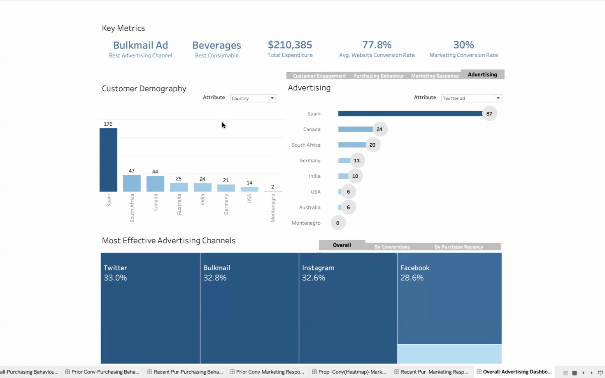

# 2Market: customers, purchases and advertising

**LSE Data Analytics Career Accelerator, Course 1 (DA101: Data Analytics for Business), September 2024.**
Excel, SQL (PostgreSQL) and Tableau. Examples run the SQL in DuckDB.

> Who are 2Market's customers, what do they buy, and which advertising reaches
> them? The answers were meant to guide where the advertising budget goes.

📄 **[Read the report](report/2Market_Report_Gokulan_DA101.pdf)** ·
[SQL as written](code/original/cleaning_up.sql) ·
[Dashboard frames](dashboard/)



## The reasoning, section by section

| | Document | Example |
|---|---|---|
| 1 | [The business context and the data](docs/01-business-context-and-data.md) | [py](examples/01_data_checks.py) |
| 2 | [Preparing and checking the data in SQL](docs/02-sql-preparation-and-checks.md) | [py](examples/01_data_checks.py) · [sql](examples/sql/01_checks.sql) |
| 3 | [Derived variables: age, income, family, propensity, recency](docs/03-derived-variables.md) | [py](examples/02_derived_variables.py) · [sql](examples/sql/02_derived_variables.sql) |
| 4 | [What customers buy: the original spending queries](docs/04-spending-and-products.md) | [py](examples/03_spending_and_products.py) |
| 5 | [The Tableau dashboard: design, and reading it against the data](docs/05-dashboard-design.md) | |
| 6 | [Who engages, and which channels work](docs/06-advertising-and-marketing-response.md) | [py](examples/04_key_metrics_and_advertising.py) · [py](examples/05_engagement_by_segment.py) |
| 7 | [Propensity and purchase recency](docs/07-propensity-and-recency.md) | [py](examples/06_propensity_and_recency.py) |
| 8 | [Insights and next steps](docs/08-insights-and-next-steps.md) | |

## Main findings

- **What sells:** beverages are half of all spending and meat items a quarter.
  This holds in nearly every segment, so segments differ in how much they
  spend, not in what they buy. High-income customers spend twelve times as
  much as low-income ones.
- **Who responds:**
  - high-income, single and childless customers respond to campaigns at
    22–27%, against 15% overall;
  - households with teenagers respond at 8%.
- **Channels:**
  - Twitter, bulk mail and Instagram tie overall (164, 163, 162
    conversions);
  - customers likely to buy convert through Instagram and Facebook;
  - those on the fence convert through bulk mail and Twitter;
  - brochures trail far behind.
- **Recency matters most:** campaign response falls from 30% for customers
  who bought in the last two weeks to 9% for those lapsed beyond 45 days,
  and it falls within every propensity group.

Every number on the dashboard reproduces from the data. Two further points:
- 47 likely duplicate customers;
- a recency filter behind the dashboard's headline tiles;
- a comparison of response by propensity, which tests the propensity groups
  independently.

These are documented in [2](docs/02-sql-preparation-and-checks.md),
[5](docs/05-dashboard-design.md) and [7](docs/07-propensity-and-recency.md).

## Running the examples

The examples run on the course data in [`data/`](data/), included with the
permission of LSE and FourthRev. From `examples/`:

```bash
python 01_data_checks.py      # ... through 06_propensity_and_recency.py
```

The Tableau workbook is not included because of its size. The
[`dashboard/`](dashboard/) images are frames from the recorded presentation.
