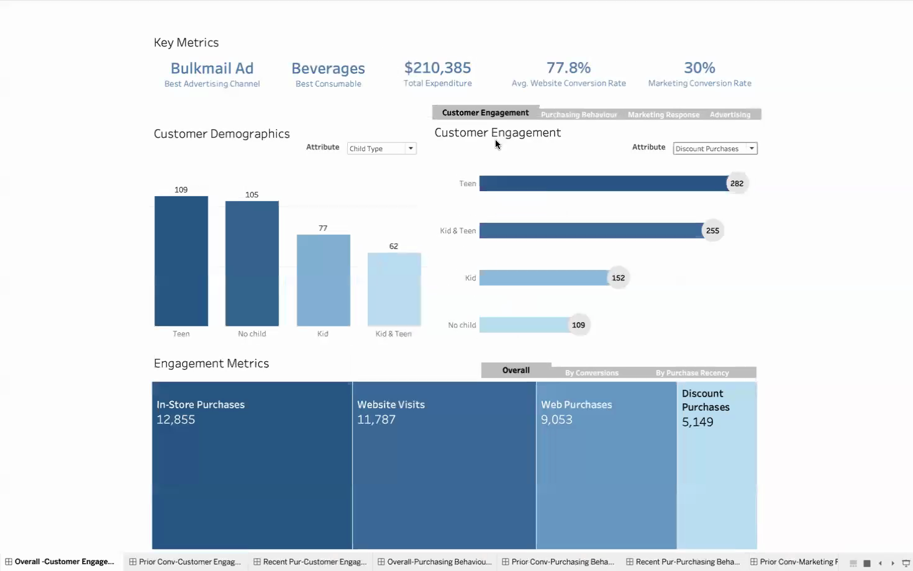
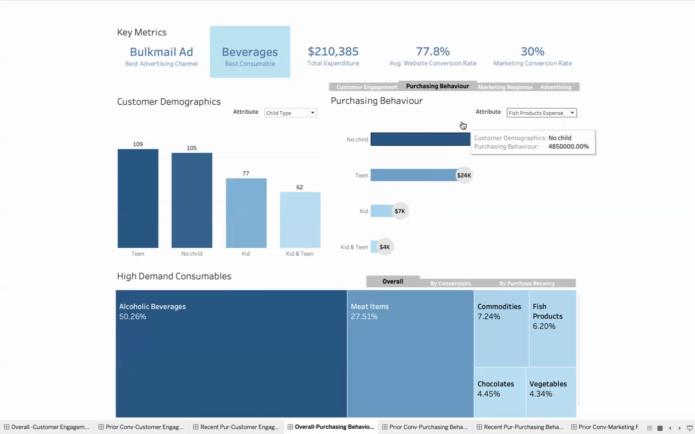
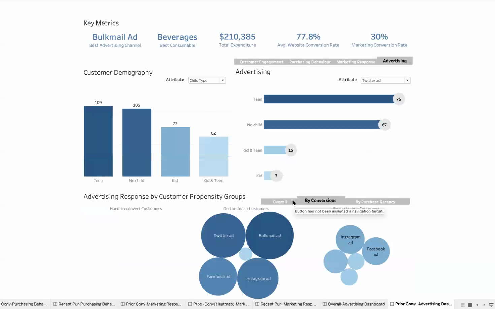
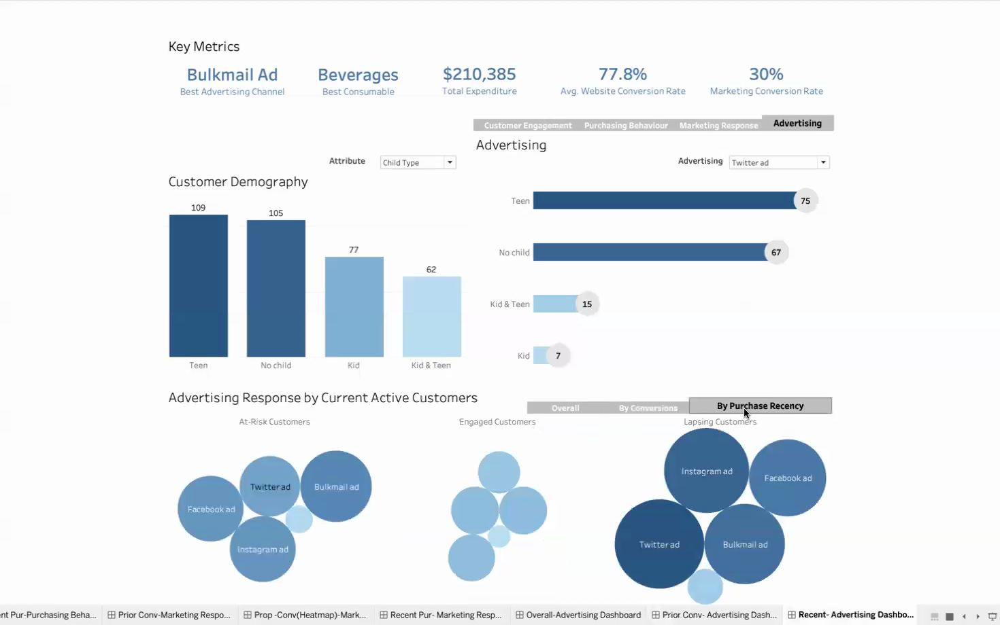

# 5. The Tableau dashboard

*Report: "Dashboard Development". Images: frames from the recorded presentation.*

## Purpose and layout

The dashboard was built to show the data grouped in ways that tell a story
about the business, and so inform decisions. Attributes were grouped by
function into four sections:

1. **Key Metrics:** five headline numbers (best channel, best consumable,
   total expenditure, website conversion rate, marketing conversion rate).
2. **Customer Demographics:** customer counts by a chosen attribute (country,
   age, income, education, marital status, child type).
3. **Customer–company interaction by demographics:** a second panel switches
   between four views:
   - Customer Engagement;
   - Purchasing Behaviour;
   - Marketing Response;
   - Advertising.
4. **Interaction by propensity and recency:** each view broken down by
   propensity group or recency group.

## Design choices (from the report)

- **Chart types:**
  - bar charts for comparing category counts;
  - bubble charts for the propensity and recency views, where bubble size
    shows each metric's weight;
  - donut charts for the make-up of marketing response;
  - large numbers for the key metrics.
- **Colour:** a single blue gradient. Darker means higher, and blue marks
  every engagement and interaction metric so the dashboard reads as one
  piece.
- **Interactivity:**
  - attribute drop-downs;
  - navigation buttons between views (Overall / By Conversions / By
    Purchase Recency);
  - tooltips on hover, which keep detail available without clutter.
- **Accessibility:** labels, tooltips, readable sizes and fonts, and few
  enough charts per view not to overwhelm.

## Reading the dashboard against the data

Every number visible in these frames reproduces from the data (examples
[03](../examples/03_spending_and_products.py) to
[06](../examples/06_propensity_and_recency.py)). Some examples:
- the consumable shares;
- the engagement totals (12,855 in-store purchases, 11,787 website visits);
- Twitter conversions by country (87, 24, 20, …) and by child type (75, 67,
  15, 7);
- the donut counts (146 positive, 18 negative and 1,593 no response among
  hard-to-convert customers).

One thing to know when reading it: **the Key Metrics tiles and the
Customer Demography chart cover the 353 Engaged customers** (recency 0–14
days), while the advertising views cover all 2,216. On the Engaged
customers:
- total expenditure is $210,385;
- web purchases per visit 77.8%;
- campaign response 30.0%.

Across all customers those are **$1.35M, 76.8% and 15.0%**. A filter on
recency is the likely cause. The tiles are correct for the group they
describe, but the dashboard does not label that group.
