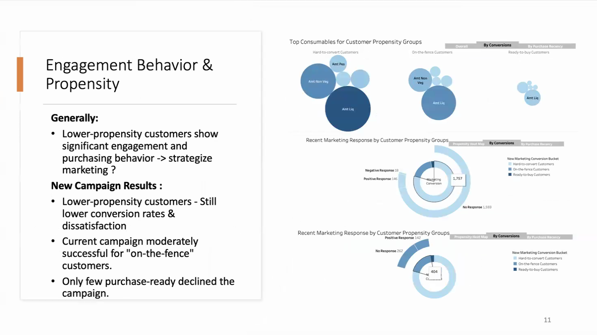
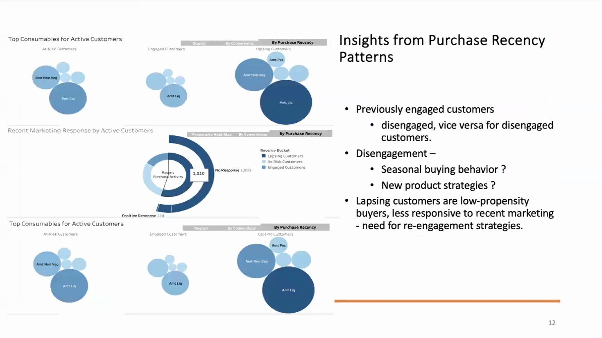

# 7. Propensity and purchase recency

*Report insights C–D. Example: [`06_propensity_and_recency.py`](../examples/06_propensity_and_recency.py).*

## The two groupings

- **Propensity:** past lead conversions.
  - Hard-to-convert: 0 conversions (1,757 customers).
  - On-the-fence: 1–2 conversions (404).
  - Ready-to-buy: 3 or more (55).
- **Recency:** days since the last purchase.
  - Engaged: 0–14 days (353).
  - At-risk: 15–45 days (653).
  - Lapsing: more than 45 days (1,210).

## The recent campaign by propensity (the dashboard's donut charts)

| Propensity | Customers | Positive | Negative (complained) | No response | Response rate |
|---|---|---|---|---|---|
| Hard-to-convert | 1,757 | 146 | 18 | 1,593 | 8.3% |
| On-the-fence | 404 | 142 | 0 | 262 | **35.1%** |
| Ready-to-buy | 55 | 45 | 0 | 10 | **81.8%** |

This is the independent test of propensity, because the recent campaign is
not part of how the groups were defined. **Propensity predicts response
strongly**: 8% → 35% → 82%.

## The report's claims, checked

**1. "Lower-propensity customers show significant engagement and
purchasing."** True in total: they are 79% of customers and make 76% of
purchases. Per customer they spend less than half as much as on-the-fence
customers ($480 vs $1,016), though they visit the website most (5.5 visits a
month). Their size makes them important. Their behaviour does not make them
the best customers. The report's conclusion was that this calls for a
rethink of marketing to them, and 19 of the 21 complaints coming from this
group support it.

**2. "The campaign was moderately successful (~50%) for on-the-fence
customers."** Moderately successful, yes: 35% responded, against 8% of the
hard-to-convert. The ~50% reads high. The donut on the dashboard shows 142 of
404. Among *engaged* on-the-fence customers, though, response reaches 68%.

**3. "Only a few purchase-ready customers declined."** Confirmed: 10 of 55
(18%).

**4. "Lapsing customers, mainly low-propensity, respond poorly to recent
marketing."** The first half is not distinctive; the second half is.
- **Response falls steeply with recency:** 30.0% for engaged customers,
  17.3% for at-risk, 9.4% for lapsing.
- **But lapsing customers have the same propensity mix as everyone:** 80%
  hard-to-convert against 79% overall.

So recency, not propensity, separates them. Within each propensity group,
response still falls with recency:

| | Hard-to-convert | On-the-fence | Ready-to-buy |
|---|---|---|---|
| Engaged | 19.4% | 68.2% | 87.5% |
| At-risk | 9.7% | 38.3% | 81.3% |
| Lapsing | 4.4% | 22.4% | 80.6% |

Ready-to-buy customers respond whatever their recency. Everyone else needs to
be reached while they are still buying.

**5. "Previously highly engaged customers are showing signs of
disengagement."** The data is a single snapshot. The ready-to-buy share is
2.3–2.6% in every recency group, so no shift is visible either way. Testing
this needs purchase history over time. The report itself framed the possible
causes (seasonal buying, new product strategies) as needing more analysis.

## A caution on direction

`Response` records whether the customer accepted the last campaign's offer.
That probably meant buying something, so responders are likely to be recent
buyers for that reason alone. Recency and response move together, but this
data cannot say which drives which.

## What follows from this

- **Re-engage lapsing customers early.** Response halves from engaged to
  at-risk, and halves again to lapsing, so contact should come within weeks
  of the last purchase.
- **Concentrate campaigns on on-the-fence customers who are still active.**
  At 68%, this is where a campaign changes the most outcomes.
- **Do not over-invest in ready-to-buy customers.** They respond at over 80%
  regardless of recency.
